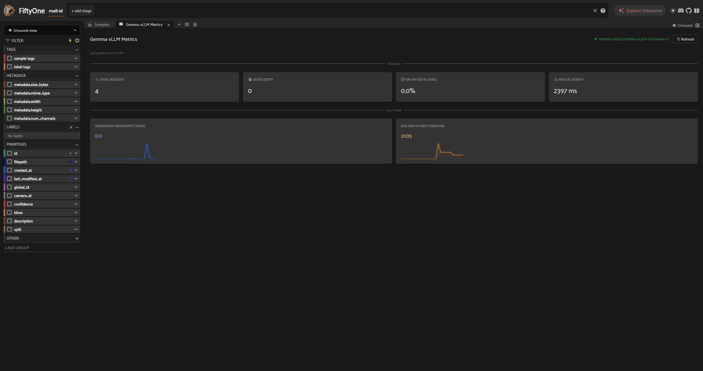
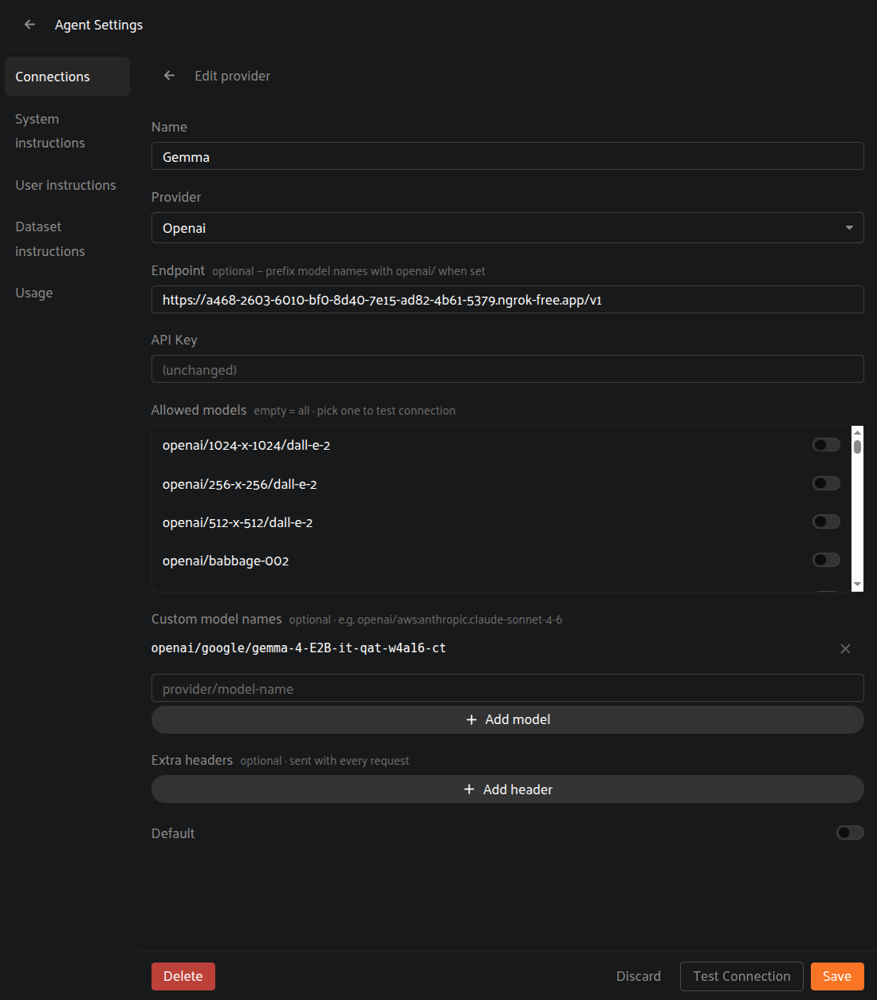

# Gemma vLLM Metrics: FiftyOne Plugin

A [FiftyOne](https://github.com/voxel51/fiftyone) plugin that watches a
[Gemma 4](https://blog.google/innovation-and-ai/technology/developers-tools/gemma-4/)
model you serve yourself. It gives you a real, local inference endpoint
(via [vLLM](https://github.com/vllm-project/vllm)) that any standard chat
client can talk to, plus a panel inside the FiftyOne App that shows the
server's own live numbers: request volume, token throughput, latency, GPU
cache usage, and queue depth.



## How it works

vLLM serves the model and already exposes a Prometheus `/metrics` endpoint
with everything worth watching, so this plugin adds no logging of its own
and no database. It just polls that endpoint and renders what's already
there.

Two different things talk to the same vLLM server. Your chat client sends
it real chat requests, and this plugin separately polls its `/metrics`
endpoint to show what those requests are costing. On the plugin side, a
Python backend
([`gemma_vllm_metrics/panel.py`](gemma_vllm_metrics/panel.py)) polls vLLM
through
[`gemma_vllm_metrics/metrics_client.py`](gemma_vllm_metrics/metrics_client.py),
and a React frontend ([`src/`](src)) renders the result as the panel shown
above.

The plugin never manages the vLLM process itself. FiftyOne panels run per
request, not as a background daemon, so they're the wrong place to own a
long lived server. vLLM comes up separately through `docker compose`
([`scripts/serve.sh`](scripts/serve.sh)), and the plugin is purely an HTTP
client against it: check status, poll `/metrics`, render both.

Metric names can drift between vLLM versions. The client is tested against
a real captured response in
[`tests/fixtures/sample_metrics.txt`](tests/fixtures/sample_metrics.txt).
If you bump the vLLM image tag, diff a fresh `curl localhost:8000/metrics`
against that fixture before trusting the panel's numbers.

## The model

This defaults to Google's own quantized checkpoint,
[`google/gemma-4-E2B-it-qat-w4a16-ct`](https://huggingface.co/google/gemma-4-E2B-it-qat-w4a16-ct),
which fits comfortably on a single 12GB consumer GPU alongside its cache
and tool calling support. The larger E4B checkpoint needs more headroom
than that leaves free; swap `MODEL_ID` in `docker/.env` to it if you have
more VRAM.

A few flags in [`docker/compose.yml`](docker/compose.yml) are worth
knowing if you're tuning this for your own hardware:

- `--enforce-eager` trades some throughput for memory, since a 12GB card
  has little room left for CUDA graph capture.
- `--max-num-seqs 1` with `--max-model-len 65536` trades concurrency for a
  longer context window, since this plugin is built for one interactive
  user at a time, not several.
- `--enable-auto-tool-choice --tool-call-parser gemma4` is required
  because most agent frameworks send a `tools` list with
  `tool_choice="auto"` on every request, and vLLM refuses that otherwise.

If you have more VRAM, raise `--max-num-seqs` and drop `--enforce-eager`
for better throughput.

## Prerequisites

- Docker with the NVIDIA Container Toolkit (`docker info | grep -i nvidia`
  should show `nvidia` as an available runtime)
- An NVIDIA GPU with a CUDA 12.9 or newer driver (check with `nvidia-smi`);
  this repo pins the `gemma4` image tag, which targets that
- About 10GB free disk for the model weights and the vLLM image
- Python 3.10+ with `fiftyone` installed
- [ngrok](https://ngrok.com/download), only if exposing the endpoint
  outside this machine

## Quickstart

Serve the model:

```bash
./scripts/serve.sh
```

This copies `docker/.env.example` to `docker/.env` on first run, brings up
vLLM, and waits for `/v1/models` to answer. First run also downloads the
model weights, so it can take a few minutes.

Install the plugin into your FiftyOne plugins directory:

```bash
PLUGINS_DIR=$(python -c "import fiftyone as fo; print(fo.config.plugins_dir)")
ln -s "$(pwd)" "$PLUGINS_DIR/gemma_vllm_metrics"
```

Launch the FiftyOne App and open the **Gemma vLLM Metrics** panel from the
`+ New panel` menu.

Point any standard chat client at the endpoint:

```
Base URL:  http://localhost:8000/v1
Model:     google/gemma-4-E2B-it-qat-w4a16-ct   (or your own MODEL_ID)
API key:   not required locally, any placeholder value works
```

Here's that same endpoint added as a custom provider in FiftyOne's own
Agent Settings:



## Exposing the endpoint on the internet

If your client isn't running on this machine, tunnel the vLLM port with
ngrok. This needs a free account and an authtoken; run
`ngrok config add-authtoken <token>` once, then:

```bash
./scripts/tunnel.sh
```

This generates a random bearer token on first run (saved to
`docker/.env.ngrok`, gitignored) and starts an ngrok tunnel that checks
that token at the edge, so requests without a matching
`Authorization: Bearer <token>` header get rejected before they ever reach
vLLM. The script prints the token and the URL to use:

```
Base URL:  https://<your-subdomain>.ngrok-free.app/v1
API key:   <the bearer token printed by scripts/tunnel.sh>
```

vLLM itself has no authentication built in, so never expose port 8000
directly without something like this in front of it.

## Configuration

| Variable | Where | Default | Purpose |
|---|---|---|---|
| `MODEL_ID` | `docker/.env` | `google/gemma-4-E2B-it-qat-w4a16-ct` | Model vLLM serves |
| `VLLM_IMAGE_TAG` | `docker/.env` | `gemma4` | `vllm/vllm-openai` image tag |
| `VLLM_PORT` | `docker/.env` | `8000` | Port for the API and `/metrics` |
| `GEMMA_VLLM_BASE_URL` | FiftyOne plugin secret or env var | `http://localhost:8000/v1` | Where the plugin looks for the server |
| `NGROK_BEARER_TOKEN` | `docker/.env.ngrok` (auto generated, gitignored) | random | Token `scripts/tunnel.sh` checks at the ngrok edge |

Plugin secrets are declared in [`fiftyone.yml`](fiftyone.yml)'s `secrets:`
block and resolved through `ctx.secrets`, falling back to the environment
variable of the same name.

## Development

```bash
# Python
pip install -r requirements.txt
pytest

# JS (hybrid panel frontend)
npm install
npm run build   # one shot build, outputs dist/index.umd.js
npm run dev     # watch mode
```

### Notes on the frontend

The installed `@voxel51/voodo` version behaves a little differently from
its own type declarations, worth knowing before touching `src/`:

- FiftyOne only loads a plugin's JS, never its CSS, so `src/index.tsx`
  imports VOODO's theme CSS directly and injects it as a style tag.
- VOODO's colors default to light mode unless a `.dark` class is present
  on an ancestor, so the panel's root element sets that itself, scoped to
  just this panel.
- Icon components ignore their `size` prop in this version, so `StatTile`
  wraps each icon in a small fixed size container instead.
- `Pill`'s icon and status dot have the same sizing problem, so
  `StatusBadge` builds its own badge and dot instead of using `Pill`.

## License

Apache 2.0. See [LICENSE](LICENSE). Matches the license of Gemma 4 and vLLM.
