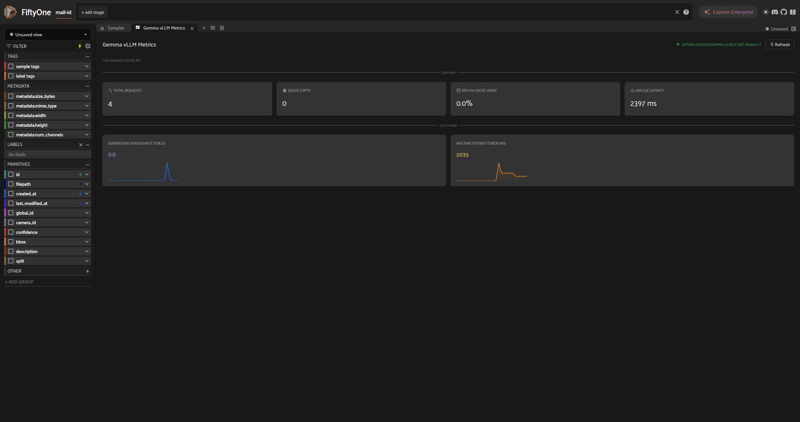
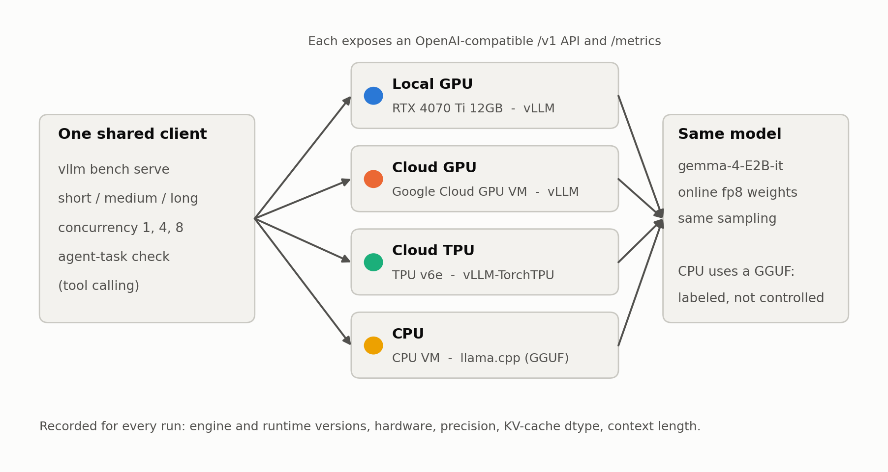
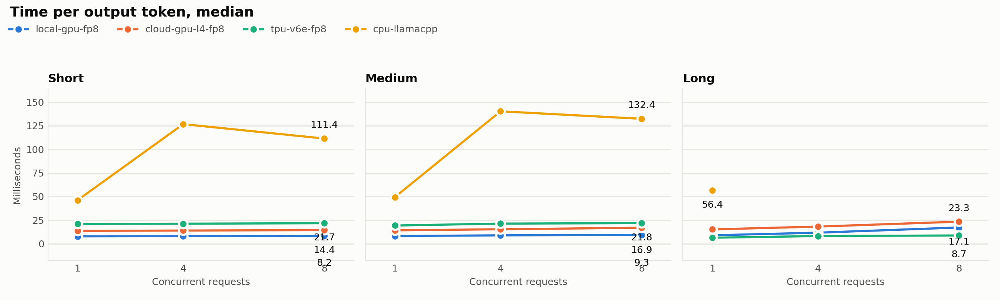
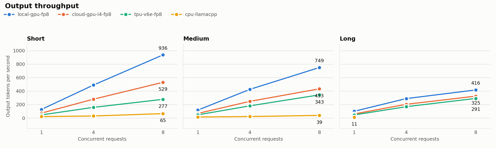
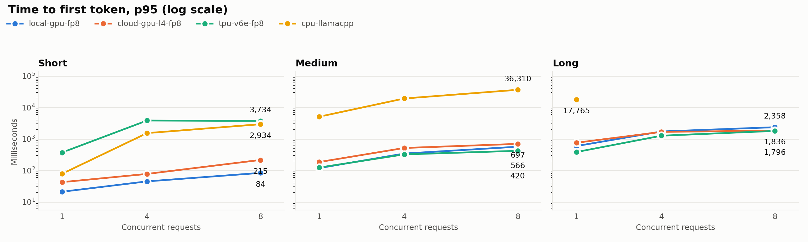
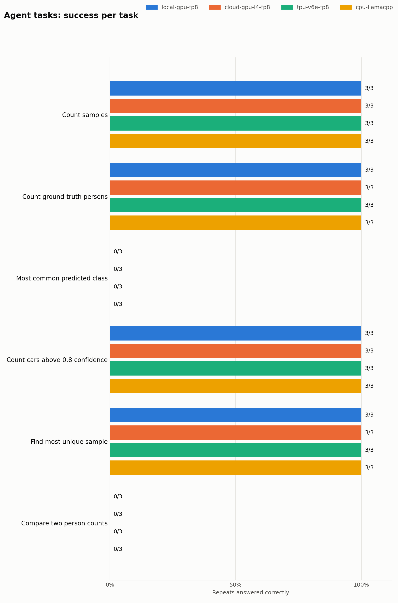
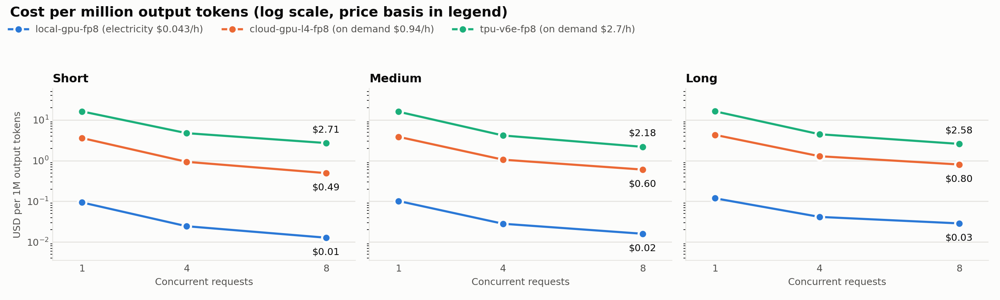

# One Model, Four Environments: Where Should Gemma 4 Run for the Voxel51 Agent?

> Draft for review. Chronological notes live in
> [`process-log.md`](https://github.com/AdonaiVera/gemma-vllm-metrics/blob/main/blogs/process-log.md).

In [Part 1](https://voxel51.com/blog/gemma-4-fiftyone-agent-open-source-model)
I served Gemma 4 on a single consumer GPU, connected it to the Voxel51 Agent
as an OpenAI-compatible endpoint, and built a
[FiftyOne panel](https://github.com/AdonaiVera/gemma-vllm-metrics) that shows
the server's live metrics.



That left an obvious question: **where should this model run?** Part 2 takes
the same model and measures it on a local GPU, a cloud GPU (an NVIDIA L4), a
Cloud TPU v6e (through vLLM-TorchTPU), and a CPU, as part of the TorchTPU
Content Sprint.

## The short answer

If you are choosing where to run Gemma 4 for the Voxel51 Agent, start from
these four facts, all measured:

1. **An agent task is tiny.** On our test set a task takes about 2.7 model
   calls, reads about 970 prompt tokens and writes about 59 output tokens.
   You are not buying tokens, you are buying hours of a machine being on.
2. **Every environment gave the same answers.** The agent passed 12 of 18
   runs (67%) on the local GPU, the cloud GPU, the TPU and the CPU, with 100%
   valid tool calls and the same tool calls and arguments (the CPU's JSON
   differs only in whitespace). The weights match everywhere except the CPU,
   which uses a GGUF build, and the TPU also used an fp8 KV cache. Pick on
   speed, cost and effort, not quality.
3. **All of them feel interactive for one user.** An agent task took 0.6 s
   on the local GPU, 1.0 s on the cloud L4, 1.8 s on the TPU, 3.2 s on
   the local CPU and 7.1 s on the 8-vCPU cloud CPU.
4. **The cost difference is about utilization.** A cloud L4 VM costs about
   $0.94 an hour ($686 a month always on, $165 if on 8 hours a weekday). A
   TPU v6e-1 costs $2.70 an hour ($1,970 always on, $475 for 8 hours a
   weekday) and was about three to five times more expensive per token than the L4 at
   concurrency 8.
   The local GPU costs about $31 a month in electricity, plus the card you
   already own.

| If you are... | Run it on | Why |
|---|---|---|
| One person exploring datasets | Your own GPU, or the CPU if you have none | Fastest per stream (100-127 tok/s); the CPU still answers a task in about 3 s |
| A small team sharing one endpoint | A cloud L4 (or any GPU you keep on) | 325-529 tok/s at 8 concurrent requests, about $0.5-0.8 per million tokens. Finding a zone with stock took effort (22 zones had none) |
| Long prompts (8K+) and low first-token latency | Probably the TPU, if you can keep it busy | First token in about 380 ms versus about 580 ms on the local GPU, 750 ms on the L4 and 17 s on the local CPU. The TPU's timing for that cell has an inconsistency (see its results), so treat this as indicative |
| Offline batch jobs | A cloud GPU first; TPU Flex-start only if you can get it | L4 is about $0.5-0.8 per million tokens at concurrency 8; TPU Flex-start is about $1.1-1.4 but needs capacity |
| Planning to move to the larger Gemma 4 models | Test the TPU | That is the case it is built for, and I did not test it |

The rest of the post shows where each number comes from. Monthly figures
are hourly price times 730 hours (24/7) or 176 hours (8 h on 22 weekdays).



## The rule: change one thing at a time

A hardware comparison is only worth reading if the hardware is the only thing
that changed. So before running anything I wrote down what has to stay fixed:
the checkpoint, the precision, the request sizes, the sampling settings and
the client. Anything that *can't* stay fixed gets labeled in the results, not
hidden.

That rule paid off immediately, because the checkpoint I used in Part 1
turned out not to be the right one for a controlled comparison.

### Finding 1: the Part 1 checkpoint can't be the controlled one

Part 1 used Google's quantization-aware-trained build,
`gemma-4-E2B-it-qat-w4a16-ct`. It's a good fit for a 12 GB card. But a
community write-up of serving Gemma 4 on a single TPU v6e chip reports that
this QAT variant fails to load there (missing weights for layers 15-34),
while the plain `google/gemma-4-E2B-it` serves fine. A different checkpoint
on TPU would break the comparison, so the plain checkpoint had to become the
common baseline.

### Finding 2: bf16 doesn't fit on a 12 GB GPU

The plain checkpoint in bf16 is the cleanest choice on paper. On the RTX 4070
Ti it ran out of memory while loading: the weights alone took **9.74 GiB** of
the 11.57 GiB the card exposes, leaving almost nothing for the KV cache.
(Gemma 4's "E2B" name is the *effective* parameter count; the real
parameter count is larger.)

The fix that keeps the comparison controlled is **online fp8 quantization of
the same checkpoint** (`--quantization fp8`) on every environment. On the
local GPU it fits with room to spare:

| Setting | Value |
|---|---|
| KV cache | 1.39 GiB (48,512 tokens) |
| Max concurrency at 9,216 tokens | about 16.9 requests |

A smaller gotcha on the way there: asking vLLM for 90% of GPU memory failed
because the desktop was already holding about 1.4 GB of VRAM. 85% works.

## The benchmark harness

Everything runs through `vllm bench serve`, the load generator the
vLLM-TorchTPU docs recommend, so every environment is measured by the same
client. The matrix is frozen in
[`workloads.json`](https://github.com/AdonaiVera/gemma-vllm-metrics/blob/main/benchmarks/workloads.json):

| Workload | Input tokens | Output tokens |
|---|---|---|
| Short | ~128 | 128 |
| Medium | ~2,048 | 256 |
| Long | ~8,192 | 512 |

Each workload runs at concurrency 1, 4 and 8, with warmup requests and three
trials, using a fixed seed, temperature 0 and ignored end-of-sequence tokens
so output lengths are comparable. That's 27 runs per environment. For every
run the harness records the server version, hardware and settings next to the
results, so a number never travels without its context.

One methodology correction, found in review. The three trials reuse the same
fixed-seed prompts, and vLLM caches prompt prefixes by default. On the L4 and
the TPU the server log shows an 86% prefix cache hit rate, and trials 2 and 3
show much lower first-token times than trial 1 (for the 8K prompt at
concurrency 1: 750, 83 and 82 ms on the L4). The local card's KV cache holds
only 48,512 tokens, so it can't keep sixteen 8K prompts around, and its
trials look the same. Averaging all trials would flatter the machines with
bigger caches, so **every result in this post uses trial 1, the cold-cache
run**. The all-trials averages are in `benchmarks/results/analysis_all_trials.csv`.

## Results: local GPU baseline

27 of 27 runs completed with zero failed requests. Each point is the cold-cache
first trial. The charts here and in the sections below show all environments.



| Workload | Concurrency | Output tok/s | p50 TTFT (ms) | p95 TTFT (ms) | p50 per-token (ms) | p95 end-to-end (ms) |
|---|---|---|---|---|---|---|
| short | 1 | 127.3 | 20 | 21 | 7.8 | 1,007 |
| short | 4 | 489.0 | 28 | 45 | 8.0 | 1,062 |
| short | 8 | 935.9 | 68 | 84 | 8.2 | 1,118 |
| medium | 1 | 117.3 | 117 | 119 | 8.1 | 2,212 |
| medium | 4 | 425.2 | 90 | 344 | 8.8 | 2,639 |
| medium | 8 | 748.6 | 102 | 566 | 9.3 | 3,216 |
| long | 1 | 100.5 | 583 | 594 | 8.9 | 5,197 |
| long | 4 | 288.5 | 1,198 | 1,726 | 11.7 | 7,433 |
| long | 8 | 416.4 | 1,093 | 2,358 | 17.1 | 10,614 |

What stands out:

- **Short and medium requests scale well.** Throughput grows almost linearly
  with concurrency, and short-request latency barely moves.
- **Long prompts are where this setup struggles.** Past concurrency 4 the
  throughput gains flatten and the first token takes over a second. Eight
  concurrent 8K-token prompts means a lot of prefill work for a small GPU.
- **Per-token speed holds up** (about 8-17 ms), so once a response starts it
  streams steadily. The pain is mostly *waiting to start* on long inputs.

> Caveat: one machine, with the desktop sharing the GPU. These numbers are a
> baseline for comparison, not a precise hardware benchmark.

## Does the agent still work?

Speed isn't the whole story. The same model can behave differently on
different deployments: quantization changes outputs, tool-call parsing is a
server feature, and some sampling parameters aren't supported on every
engine. So the harness includes a small agent-task check: a plain tool-calling
loop with four read-only FiftyOne tools over a 24-image dataset, six
questions, and answers computed from the data itself.

On the local GPU (fp8 E2B, thinking off, 6 tasks x 3 repeats):

| Metric | Result |
|---|---|
| Task success | 67% (4 of 6 tasks) |
| Valid tool calls | 100% |
| Average turns | 2.7 |
| Average time per task | 0.61 s |

Tool calling works. The two failures are instructive, and they are the
model's, not the harness's:

- Asked for the most common predicted class other than "person", the model
  skipped the tool that answers it directly. It guessed a few vehicle
  classes one at a time and stopped at "car" (the answer is "kite").
- Asked for the *difference* between two counts, it looked up both correctly
  and then reported one of them instead of subtracting.

### A fairness bug I almost published

My first CPU run scored **83%** against the GPU's **67%**, and the CPU
solved the task the GPU failed. It looked like hardware changing the answer.
It wasn't. Gemma 4 has a thinking mode, and the two servers disagreed about
it: llama.cpp auto-detects it from the chat template and turns it on, while
my vLLM server ran with it off. The tell was token counts. On the trivial
"how many samples?" task the GPU generated 22 completion tokens and the CPU
generated 381. The CPU was reasoning before every answer, which also explains
why its agent runs took 30 to 90 seconds and the GPU's took about one.

The fix is to stop trusting server defaults. The agent check now sets
`chat_template_kwargs.enable_thinking` on every request, so all engines run
the same way, and it saves each run's tool-call trace. With thinking off on
both:

| Environment | Success | Valid tool calls | Avg time per task |
|---|---|---|---|
| Local GPU (vLLM fp8) | 67% | 100% | 0.61 s |
| CPU (llama.cpp Q8_0) | 67% | 100% | 3.2 s |

Same score, same failing tasks, and the traces match call for call. The
quantization and the engine did not change what the agent does; the thinking
setting did. Lesson for any cross-engine comparison: pin every behavioral
switch (thinking, sampling, templates) explicitly, then check token counts
before you believe a quality difference.

Thinking is a real lever, not just a nuisance. With it explicitly on (CPU,
same traces otherwise), the agent scores **83%**: it solves `top_pred_class`
(3 of 3) by reasoning its way to the label-discovery tool, and still fails
`person_gap`. The cost is time: 37 s per task on average instead of 3.2 s,
and 1,921 tokens on the hardest task instead of about 100. So the choice
between thinking on and off is a quality-versus-latency decision the
deployment has to make deliberately. The thinking-on variant is only run on
CPU so far, because vLLM needs a reasoning parser to return it cleanly.

That is a useful baseline: if TPU shows a different success rate or invalid
tool calls with the same settings, the deployment caused it.

## Cloud TPU v6e with vLLM-TorchTPU

### Getting a TPU was the hard part

I asked for a single v6e chip and it took several attempts. Two Flex-start
requests (one in a zone Google doesn't list for v6e Flex-start, one in a zone
it does) sat in `WAITING_FOR_RESOURCES` for their full hour and failed with
`Max start time passed`. An on-demand attempt was rejected outright, because
on-demand requests can't carry a hard stop (`--max-run-duration` is
Flex-start only). A one-hour on-demand wait expired the same way. The fifth,
on-demand in two zones with a two-hour window, was granted in `us-east5-b`
after about an hour and a half.

Two lessons for anyone planning this:

- **Quota is not capacity.** The project had quota for the chip, and a
  request still waited for hours. Quota is also per zone: several zones had a
  limit of 0, so only `us-east5-a` and `us-east5-b` would even accept a request.
- **The safety net matters.** Without a hard stop, I ran a watchdog script
  that deletes the VM by exact name after a time limit, and tore everything
  down myself the moment the metrics were saved. A `WAITING_FOR_RESOURCES`
  request costs nothing; a forgotten VM does.

### Does Gemma 4 E2B run on vLLM-TorchTPU?

Yes, with the same flags as the other environments. The docs only validate
the larger Gemma 4 models (31B dense and 26B-A4B MoE) and list v6e as
supported but not covered by CI, so this was the biggest unknown. On a plain
v6e-1 VM:

- `uv pip install vllm-torchtpu` worked as documented (about 4 minutes,
  `vllm-torchtpu 0.33.0`, `libtpu 0.0.50`).
- `vllm serve google/gemma-4-E2B-it --quantization fp8` with the `gemma4`
  tool-call parser and `--async-scheduling` started and served. The first
  start compiled TPU graphs for about 15 minutes.
- Tool calling worked: 100% valid tool calls in the agent check.
- The Prometheus `/metrics` endpoint is there, with 403 `vllm:` series, so
  the Part 1 panel should work against it unchanged.

One thing I didn't expect: on v6e the backend automatically picks an **fp8
KV cache** (`fp8_e5m2`; it says so in the server log). The local GPU used the
default KV precision. The weights match, the KV cache doesn't, so this leg is
not perfectly controlled. With a short context and a small model I'd expect
the effect to be small, but I can't prove it.

### Results

27 of 27 runs completed with zero failed requests. Same workloads, same
client; each point is the cold-cache first trial.

| Workload | Concurrency | Output tok/s | p50 TTFT (ms) | p95 TTFT (ms) | p50 per-token (ms) | p95 end-to-end (ms) |
|---|---|---|---|---|---|---|
| short | 1 | 46.3 | 37 | 370 | 20.8 | 3,016 |
| short | 4 | 158.4 | 71 | 3,842 | 21.2 | 6,532 |
| short | 8 | 277.1 | 98 | 3,734 | 21.7 | 6,490 |
| medium | 1 | 47.1 | 123 | 123 | 19.2 | 5,445 |
| medium | 4 | 180.7 | 119 | 323 | 21.3 | 5,810 |
| medium | 8 | 343.3 | 135 | 420 | 21.8 | 6,273 |
| long | 1 | 46.0 | 383 | 384 | 6.3 | 11,150 |
| long | 4 | 168.4 | 337 | 1,266 | 8.1 | 13,209 |
| long | 8 | 290.6 | 395 | 1,796 | 8.7 | 19,960 |





What stands out:

- **For this small model, one v6e chip is not faster than a desktop GPU.**
  A single stream decodes at about 46-47 tokens/s on the TPU against 100-127 on
  the RTX 4070 Ti, and at concurrency 8 the GPU is ahead on throughput too
  (for example 936 vs 277 tokens/s on short requests).
- **Long prompts are where the TPU looks best, with a caveat.** At
  concurrency 1 the 8,192-token prompt starts streaming in 383 ms on the TPU,
  against 583 ms on the local GPU and 750 ms on the L4, and at concurrency 8
  the TPU's p95 is 1,796 ms against 2,358 ms (local) and 1,836 ms (L4). I'd
  expect a TPU to be good at prefill, but I didn't test that explanation, and
  the caveat below applies to exactly this cell.
- **Throughput was still scaling at the top of the test.** The server was
  capped at 8 concurrent sequences, and TPU throughput grows almost linearly
  up to that cap (46, 158, 277 tokens/s on short requests). Concurrency 8 is
  where my test stops, not where the chip does.
- **The first requests are slow.** Short requests have a p95 time to first
  token of 3.7-3.8 s at concurrency 4 and 8 against a 71-98 ms median, which
  looks like first-use compilation of new batch shapes that four warm-up
  requests didn't cover. I'd warm up harder before drawing conclusions about
  tail latency.
- **A number I don't trust.** For the long workload the benchmark reports a
  per-token time of 6.3 ms, but throughput (46.0 tokens/s) says about 21 ms,
  like the short workload. The per-request timings for the medium and long
  cells also don't add up: at concurrency 1 the long run took about 11 s per
  request by wall clock, but the reported mean end-to-end latency is 6.2 s. I
  didn't have the VM to chase it, so use throughput for the TPU, and treat its
  long-prompt first-token time as indicative.



The agent check on the TPU matches the others: 67% success (12 of 18 runs),
100% valid tool calls, the same two failing tasks. The deployment did not
change what the agent does.

## Cloud GPU and CPU

### Cloud GPU: NVIDIA L4

The cloud GPU is an NVIDIA L4 (24 GB) on a `g2-standard-8` VM, running the
same container image, the same fp8 checkpoint, the same server settings and
the same 27-run matrix as the local card. It is a different GPU from the
RTX 4070 Ti, with the same Ada architecture but about 60% of the memory
bandwidth (300 versus 504 GB/s), so expect it to be slower per stream.

Getting it was easier than the TPU, but not trivial: the L4 was out of stock
in 22 zones across the US and Europe before one in Montreal
(northamerica-northeast1-b) granted it. Quota was never the problem (32 L4s,
none used). One difference from the TPU worked in my favor: a Compute Engine
VM accepts a hard maximum run time that Google enforces by deleting the VM,
so I did not depend on my own watchdog alone.

| Workload | Concurrency | Output tok/s | p50 TTFT (ms) | p95 TTFT (ms) | p50 per-token (ms) | p95 end-to-end (ms) | Cost per 1M (on-demand) |
|---|---|---|---|---|---|---|---|
| short | 1 | 72.7 | 42 | 42 | 13.5 | 1,766 | $3.59 |
| short | 4 | 279.4 | 67 | 78 | 13.9 | 1,846 | $0.93 |
| short | 8 | 529.2 | 106 | 215 | 14.4 | 2,036 | $0.49 |
| medium | 1 | 67.8 | 183 | 185 | 14.1 | 3,802 | $3.85 |
| medium | 4 | 247.5 | 159 | 517 | 15.3 | 4,440 | $1.06 |
| medium | 8 | 433.0 | 188 | 697 | 16.9 | 5,361 | $0.60 |
| long | 1 | 60.7 | 750 | 757 | 15.1 | 8,499 | $4.30 |
| long | 4 | 203.5 | 517 | 1,673 | 18.1 | 11,412 | $1.28 |
| long | 8 | 324.7 | 600 | 1,836 | 23.3 | 15,450 | $0.80 |

All 27 runs succeeded, with zero failures. The numbers line up with the
hardware. A single stream decodes at 61-73 tokens/s (about 14 ms per token),
roughly 55-65% of the local card, and throughput at concurrency 8 is 325-529
tokens/s. The agent check matches every other environment: 67% success (12 of
18), 100% valid tool calls, about 1.0 s per task.

The first token on the 8K prompt is slower than the local card's at
concurrency 1 (750 ms versus 583 ms), which fits the L4's lower compute and
memory bandwidth. At concurrency 4 and 8 it is faster (517 and 600 ms versus
1.2 and 1.1 s). The local card holds only 48,512 tokens of KV cache against
the L4's 359,520, so eight 8K requests don't fit in it at once; I think that
is why, but I didn't isolate it.

The billed window was about 1 hour 49 minutes, roughly $1.70 at $0.94 per
hour.

**CPU.** The CPU runs a different engine (llama.cpp) and a different weight
format (GGUF Q8_0), so this is labeled as not controlled. To keep the run
short I used a reduced matrix: all three concurrencies for short requests
with three trials, medium with one trial, and long at concurrency 1 only.
13 cells, zero failures. I also ran the same llama.cpp setup on the cloud
VM's 8 vCPUs, described after the table.

| Workload | Concurrency | Output tok/s | p50 TTFT (ms) | p95 TTFT (ms) | p50 per-token (ms) | p95 end-to-end (ms) |
|---|---|---|---|---|---|---|
| short | 1 | 21.6 | 74 | 78 | 46.0 | 6,042 |
| short | 4 | 30.3 | 757 | 1,532 | 126.7 | 17,623 |
| short | 8 | 65.4 | 1,386 | 2,934 | 111.4 | 17,574 |
| medium | 1 | 15.0 | 4,808 | 5,074 | 49.3 | 17,716 |
| medium | 4 | 22.4 | 5,728 | 19,223 | 140.3 | 58,095 |
| medium | 8 | 39.0 | 6,003 | 36,310 | 132.4 | 85,977 |
| long | 1 | 11.4 | 17,213 | 17,765 | 56.4 | 46,375 |

The CPU is usable for one person and nobody else: about 22 tokens/s on short
requests, and a long 8,192-token prompt takes 17 seconds before the first
token appears. Medium prompts at concurrency 8 reach a p95 time to first
token of 36 seconds. It is a valid fallback for a single user and a
non-starter for a shared endpoint.

**Cloud CPU (a `g2-standard-8` VM's 8 vCPUs, GPU idle).** I ran the same
llama.cpp setup and the same reduced matrix, plus the agent check. This leg
spans two VMs of the same type: the short cells ran on the L4 VM in Montreal,
and the medium cells, the long cell and the agent check on a second VM in
Singapore, because the first one was deleted before the CPU matrix finished
(about another 1 hour 33 minutes of billing). The local machine's CPU has 24 threads; the cloud VM has 8. 13
cells, zero failures.

| Workload | Concurrency | Output tok/s | p50 TTFT (ms) | p95 TTFT (ms) | p50 per-token (ms) | p95 end-to-end (ms) |
|---|---|---|---|---|---|---|
| short | 1 | 10.5 | 924 | 952 | 89.5 | 12,353 |
| short | 4 | 17.1 | 1,874 | 3,401 | 220.2 | 31,351 |
| short | 8 | 30.0 | 3,439 | 6,472 | 241.4 | 36,935 |
| medium | 1 | 6.7 | 13,016 | 13,080 | 101.3 | 39,089 |
| medium | 4 | 11.1 | 584 | 119,086 | 256.6 | 128,900 |
| medium | 8 | 15.4 | 789 | 188,165 | 311.1 | 208,144 |
| long | 1 | 4.8 | 0 | 53 | 211.9 | 110,228 |

The cloud CPU is about half as fast as the local one: 10.5 tokens/s at
concurrency 1 on short requests (21.6 locally), and 4.8 tokens/s on the long
prompt (11.4 locally). An 8,192-token request takes about 110 seconds end to
end at the 95th percentile. The agent check gave the same 67% (12 of 18) with
100% valid tool calls, but each task took 7.1 s, against 3.2 s on the local
CPU.

One caution: I don't trust the time-to-first-token column for the medium
concurrency 4 and 8 cells and the long cell on this VM. For medium the median
(0.6-0.8 s) sits next to a 95th percentile of 119 and 188 seconds, and for
long the median is 0 ms with a p95 of 53 ms, while a request took about 110
seconds. Candidates are llama.cpp reusing a cached prompt (the warm-up
requests use the same prompts) and the server streaming an empty first chunk
before the prompt was processed. I didn't confirm either. Throughput and
end-to-end latency don't depend on that, so use those. It confirms the point
above: a CPU, local or rented, is a single-user fallback.

## Cost per million output tokens

The cost chart answers "what does a million output tokens cost on each
environment?" using one formula:

```
cost per 1M output tokens = price per hour / (output tokens per second x 3600) x 1,000,000
```



It assumes the accelerator is kept busy at that concurrency level, which is
the best case for every environment. The prices:

- **Cloud L4 (g2-standard-8): about $0.94 per hour on-demand** in
  Montreal, from third-party price trackers, because Google's own page
  snippet was ambiguous (a $0.854 figure may belong to another region).
  Check your billing report.
- **TPU v6e-1: $2.70 per chip-hour on-demand** ($1.35 with Flex-start), per
  Google's TPU and DWS pricing pages. The page I could reach looked stale,
  so check your own billing report. Our run used on-demand.
- **Local GPU: $0.043 per hour of electricity**, an assumption (285 W at
  $0.15/kWh), not a measurement, and it does **not** include buying the GPU.
- **CPU: not priced.** There's no honest hourly number for a machine I own,
  so it isn't on the chart.

At concurrency 8 the L4 comes to about $0.49-0.80 per million output tokens
(about $3.6-4.3 at concurrency 1), and the TPU to about $2.2-2.7 on-demand
(about $1.1-1.4 with Flex-start, about $16 at concurrency 1). For this model
the L4 is roughly three to five times cheaper per token than the TPU, in the
best case, and with a third-party L4 price. The
local GPU is one to two orders of magnitude cheaper, because the electricity
is cheap and the hardware is already paid for. That comparison flatters the
GPU, so read it as "marginal cost once you own it".

The best case is also not what I paid. The TPU was billed for about 2 hours
45 minutes (roughly $7.40), and in that time it generated about 334,000
output tokens. That is an **effective $22 per million**, ten times the chart,
because the machine spent most of its billed time waiting: 15 minutes
compiling, and about an hour and a half stalled on a bug in my own script
(more on that in the process log). Utilization is the real cost driver on a
TPU.

## What it means for a real deployment

Because an agent task writes only about 59 tokens, token cost is almost
irrelevant here. The monthly bill is set by how many hours the machine is on:

| Setup | Monthly cost | What you get |
|---|---|---|
| Local GPU, on 24/7 | about $31 electricity (assumed) plus the card | 0.6 s per task, no capacity risk |
| Cloud L4, on 24/7 | about $686 | 1.0 s per task, no hardware to own |
| Cloud L4, 8 h on weekdays | about $165 | same, must be turned on and off |
| TPU v6e-1 on-demand, 8 h on weekdays | about $475 | 1.8 s per task, fast long prompts, must be turned on and off |
| TPU v6e-1 on-demand, 24/7 | about $1,970 | same, always ready |
| TPU v6e-1 Flex-start, 8 h on weekdays | about $240 | same, but capacity is not guaranteed and I could not get it |

Two consequences follow:

- **Size for concurrency, not tokens.** At concurrency 8 the TPU produced
  about 330 output tokens/s, which is far more than a team of agent users
  generates. I did not test agent tasks under concurrent load, but a single
  E2B replica on any of these machines is unlikely to be the bottleneck.
- **A chip you do not keep busy is expensive.** Our effective cost was $22
  per million tokens, ten times the best case, because the VM was idle. For
  a team workload, a cloud L4 is the cheaper rented choice for this model
  and an owned GPU is cheaper still. The TPU only wins when very low
  first-token latency on long prompts or a larger model makes it necessary.

## So where should Gemma 4 run?

| | Local GPU (RTX 4070 Ti) | Cloud GPU (L4) | Cloud TPU v6e-1 | CPU (llama.cpp) |
|---|---|---|---|---|
| Single-stream decode | 100-127 tok/s | 61-73 tok/s | 46-47 tok/s | 11-22 local, 5-11 cloud |
| Time to first token, 8K prompt, concurrency 1 | 583 ms | 750 ms | 383 ms (indicative) | 17 s local, unreliable on cloud |
| Throughput at concurrency 8 | 416-936 tok/s | 325-529 tok/s | 277-343 tok/s | 39-65 local, 15-30 cloud |
| Cost per 1M tokens at concurrency 8 | about $0.01-0.03 (electricity only) | about $0.49-0.80 | about $2.2-2.7 on-demand | not priced |
| Agent success (thinking off) | 67% | 67% | 67% | 67% |
| Agent time per task | 0.6 s | 1.0 s | 1.8 s | 3.2 s local, 7.1 s cloud |
| Operational effort | one container | find a zone with stock, one VM | capacity, quota, 15 min compile | one container |

Recommendation by use case (the table at the top has the same advice by
who you are), with the caveat that this is one small model on one chip:

- **Interactive, single user:** the local GPU. It's the fastest per stream and
  the cheapest per token, if you already own one (the card itself isn't in
  that price).
- **A small team on rented hardware:** the cloud L4, at about $0.5-0.8 per
  million tokens and about $165 a month for working hours, with the caveat
  that the price is from third-party trackers.
- **Long-context prompts on a shared endpoint:** the TPU looks best on first
  token (383 ms versus 583 ms on the local card and 750 ms on the L4 at 8K),
  but that cell's timings have an inconsistency, and it only pays if you keep
  the chip busy.
- **Offline batch:** the L4 at about $0.5-0.8 per million tokens is the cheaper
  rented option here; the TPU's Flex-start rate of about $1.1-1.4 is reasonable
  too, but only if you can get the chip.
- **A single user with no GPU:** the CPU works, slowly.

What I did *not* test is the case the TPU is built for: the larger Gemma 4
models (31B, 26B-A4B) that the docs actually validate and that don't fit on a
12 GB desktop GPU. A single v6e chip is under-used by E2B, and I'd expect the
picture to change there.

## Reproduce it

Everything is in the repository:
[`benchmarks/`](https://github.com/AdonaiVera/gemma-vllm-metrics/blob/main/benchmarks) has the workloads, the runner, the analysis
and the agent check, and [`docker/compose.bench.yml`](https://github.com/AdonaiVera/gemma-vllm-metrics/blob/main/docker/compose.bench.yml)
has the local GPU setup. The CPU setup is in
[`docker/compose.cpu.yml`](https://github.com/AdonaiVera/gemma-vllm-metrics/blob/main/docker/compose.cpu.yml) and the TPU runbook is
in [`deploy/tpu/`](https://github.com/AdonaiVera/gemma-vllm-metrics/blob/main/deploy/tpu). The cloud GPU runbook, with
preflight, create, run, a zone sweep, teardown and a watchdog, is in
[`deploy/gpu/`](https://github.com/AdonaiVera/gemma-vllm-metrics/blob/main/deploy/gpu). The same harness works against any
OpenAI-compatible endpoint.

## Limits of this study

- One machine per environment, one model, one checkpoint family.
- Online fp8 on every environment is a compromise for fairness; it is not
  the best quality or the best speed on any of them.
- The agent check is a small proxy for the Voxel51 Agent, not the full
  application.
- Prices change. The TPU price is from search snippets of Google's pages, and the L4 price is from third-party trackers.
- Trial 1 is the only trial used for every number, to avoid prefix-cache hits in later trials; that gives one sample per cell.
- The cloud CPU leg ran on two VMs of the same type, in two regions.
- The CPU legs used a reduced matrix (single trial for medium and long), and time to first token on the cloud CPU's medium and long cells is unreliable (see above).
- The L4 is not the same card as the local RTX 4070 Ti, and I did not isolate why its 8K time to first token is better.
- The monthly figures are arithmetic on hourly prices, not invoices.
- The TPU ran with an fp8 KV cache chosen by the backend; the GPU did not.
- The server cap of 8 sequences means no environment was pushed to saturation.

## Follow-up tasks

Four things I would do next, in order of value:

1. **Test the larger Gemma 4 models on the TPU** (31B and 26B-A4B). This is the
   case the TPU is built for and the one E2B can't show.
2. **Run the agent check with thinking mode on for the GPU and TPU.** It needs
   a reasoning parser configured in vLLM. On the CPU, thinking lifted success
   from 67% to 83% at ten times the latency per task.
3. **Run agent tasks under concurrent load**, to turn "one replica is probably
   enough for a team" into a measurement.
4. **Explain the TPU's long-workload per-token number.** The benchmark reports
   6.3 ms, but throughput implies about 21 ms, and the per-request timings in
   the medium and long cells don't match wall-clock time. It needs a second run with a
   longer warm-up, which would also show whether the short-request tail
   latency is first-use compilation.
